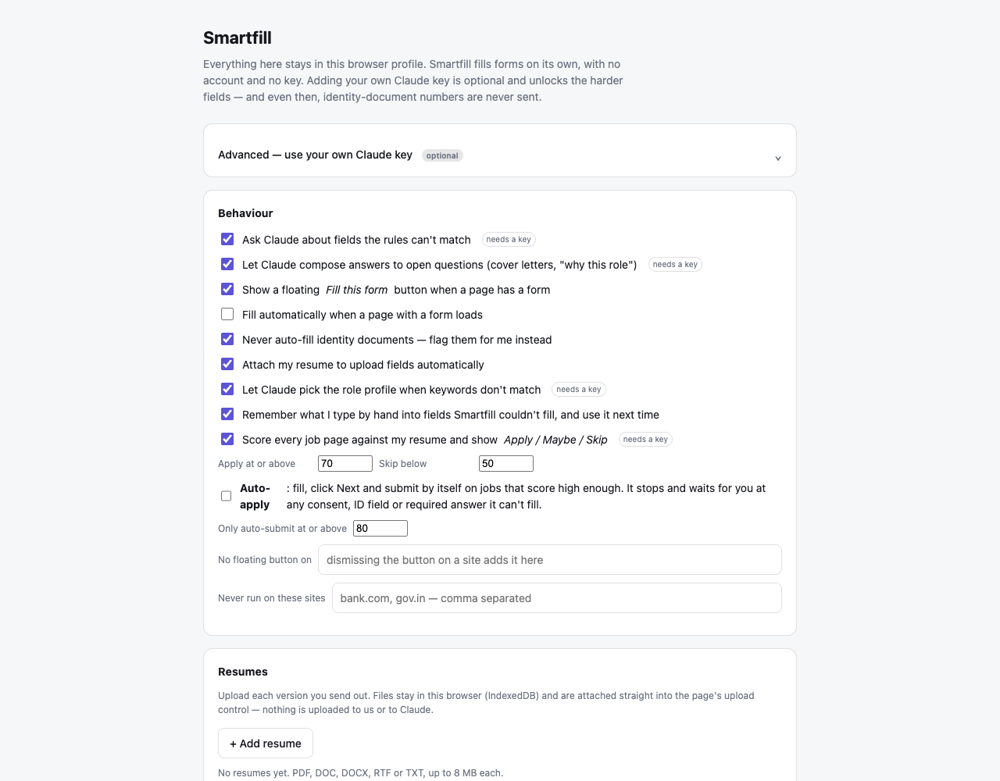
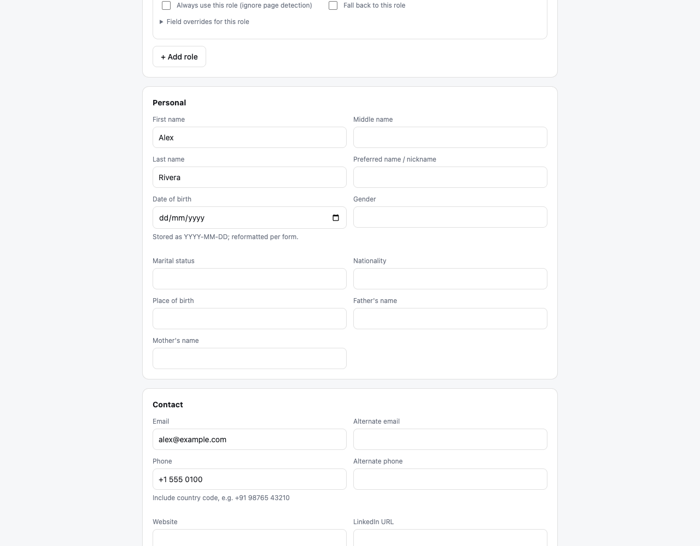

# Smartfill — Smart Form Autofill for Chrome

**AI-assisted form autofill for Chrome — local-first, privacy-aware, and honest about what it does.**

[](https://github.com/aby050/smartfill/actions/workflows/ci.yml)
[](LICENSE)

-brightgreen)
[](CONTRIBUTING.md)

Smartfill fills forms from a profile you keep locally, attaches the right resume for the
role you're applying as, and asks Claude only about the fields its rules can't place —
including open questions like "why do you want this role", answered from your own
summary and cover-letter text.

## Screenshots

| Settings | Profile |
|---|---|
|  |  |

## Highlights

- **Works without an API key.** ~70 deterministic rules plus `autocomplete` tokens fill most forms instantly, offline.
- **Optional AI fallback.** Bring your own Claude API key for oddly worded fields, free-text answers, role detection and a job-fit score.
- **Role profiles.** Keep variants (Product Manager, Engineer, …) with their own resume, keywords and field overrides.
- **Resume attachment.** Real `DataTransfer` uploads, dropzone support, `accept`-aware, undoable.
- **Never answers consents for you.** Legal declarations are detected and left to you, unless you saved a standing answer.
- **Component-library aware.** Adapters for PrimeNG dropdowns, autocompletes and calendars that have no native `<select>`.
- **Repeated rows.** Fills one block per person on booking and group forms, clicking the form's own "add" button.
- **Private by design.** No server, no telemetry. Passwords, OTPs, card numbers and identity documents never leave the page.

## Table of contents

- [Install](#install) · [Use](#use) · [Role profiles](#role-profiles) · [Resumes](#resumes) · [Job fit score](#job-fit-score)
- [How it decides](#how-it-decides) · [What goes where](#what-goes-where) · [Testing it](#testing-it) · [Layout](#layout)
- [Contributing](#contributing) · [License](#license)

## Install

1. `chrome://extensions` → turn on **Developer mode** → **Load unpacked** → pick this folder.
   Keep it somewhere permanent: an unpacked extension is loaded **from its folder**, so if
   that folder disappears — an unplugged drive, a moved directory — Chrome disables the
   extension.
2. The options page opens on first install. Fill in as much of the profile as you care
   about — it saves as you type. **No account and no API key are needed**; the extension
   fills forms out of the box.
3. Optional, under *Advanced*: paste your own Claude API key and hit **Test**. That adds
   the judgement calls — oddly worded fields, written answers to open questions, role
   detection and the job fit score. It is your key, billed to you, used straight from your
   browser. Get one at [console.anthropic.com](https://console.anthropic.com/settings/keys),
   then add credits under *Plans & Billing*.

## Use

**A floating button appears by itself** once a page turns out to have a form worth
filling — bottom right, showing how many fields it can handle. One click fills. The ×
dismisses it for that site and remembers. It watches for single-page apps that render
their form long after load, and the counting is entirely local: no network call, ever.

Turn it off, or clear the per-site list, under *Behaviour* in options.

Click the toolbar button. It reads the form first — you get a count of what it can fill,
which role it picked, whether a resume is ready, and how many consents it is leaving alone —
and only then offers **Autofill this form**. The click that changes the page is always yours.

**Alt+Shift+F** skips the preview and fills immediately, as does right-click → *Smartfill this form*.
- A panel appears bottom-right listing every field, where the value came from
  (`matched` = local rule, `AI` = Claude), and what went in. Click a row to jump to
  that field and edit the value inline.
- **Undo all** reverts the whole fill.
- Filled fields are outlined: green for a rule match, violet for an AI match,
  dashed amber for something that needs your eye.

## Role profiles

You rarely apply as one person. A **role** is a named variant — Product Manager,
Project Manager, Engineer — carrying:

- its own **resume**, attached automatically to the page's upload control;
- **keywords** that identify a matching job page (`product manager, product owner, roadmap`);
- **overrides** for the fields that actually differ between roles: job title, summary,
  skills, cover letter, expected salary, portfolio links.

Everything else comes from the base profile, so your address and phone number are
written once.

**How the role gets picked**, in order: a role you've pinned → keyword match against
the page title, heading and body → Claude, if keywords are inconclusive (a cheap
Haiku call that sees only the role names and the job text, never your profile) →
your default role. The panel shows which role was used and why, and a dropdown
there re-runs the fill as a different one.

## Resumes

- Upload as many versions as you like in options. PDF, DOC, DOCX, RTF or TXT, 8 MB each.
- Files live in **IndexedDB on the extension's own origin** — not in `chrome.storage`,
  not on any server, and never sent to Claude. Only the filename ever leaves the machine.
- Attachment works by building a `DataTransfer` and assigning its `FileList` to the
  input, then firing `input`/`change` — which is how a real file selection looks to
  the page. Dropzones with no exposed input get a synthetic `dragenter`/`dragover`/`drop`.
- The target is classified first: **resume** fields get the file, **cover letter**,
  **photo** and **ID document** uploads are listed for you to handle yourself.
- The input's `accept` attribute is honoured — a DOCX won't be forced into a PDF-only field.
- Already-attached files aren't replaced unless you choose *Fill & replace*.
- Undo clears what it attached.

## Job fit score

On a page that reads like a job posting, the panel offers **Score this job**. Claude
reads your resume PDF directly — the Messages API takes a base64 `document` block, so
nothing here has to parse a PDF — alongside the posting and your profile text, and
returns:

- a **0–100 score** with a one-line verdict, colour-coded (green ≥ 75, amber ≥ 50, red below)
- **where you match** and **your gaps**, judged only on evidence in the resume
- **words the posting uses that your resume never does** — the ones a keyword filter screens on
- **1–3 concrete edits** that would raise the score

It is deliberately calibrated rather than encouraging: an inflated score costs you an
application. Results are **cached per job URL for 7 days** against the resume that was
used, so re-filling the same form is free; *Rescore* forces a fresh call.

A DOC/DOCX resume can't be sent as a document block — those score from your profile
text alone, and the verdict says so. Keep a PDF version for the best result.

**LinkedIn is not readable.** It is login-walled, so the score uses the URL plus the
summary and skills you've written yourself. Put your LinkedIn "About" text into the
role's summary override and it feeds straight in.

## Moving to another machine

**Nothing is ever learned from a form.** Everything the extension types comes from what
you entered in options, so a fresh install fills correctly from the first form it sees —
provided its data got there. Two routes:

**Google account sync (automatic).** Profile, roles and settings ride `chrome.storage.sync`,
which follows whatever Google account is signed into Chrome — no OAuth, no server, no client
ID to register. Install on a second machine signed into the same account and the profile is
pulled down on install, before you open anything. The payload is chunked into 7 KB pieces to
clear Chrome's 8 KB-per-item cap, stale chunks are dropped when the payload shrinks, and an
oversized profile is refused outright rather than half-written.

Two things deliberately stay behind:

- **Resume files** — megabytes against a 100 KB account allowance. They can't fit, so they
  travel by export/import.
- **Your API key** — unless you've set a Chrome sync passphrase, synced values are readable
  by Google. A long-lived API key doesn't belong there; paste it again on the new machine.

**Export / import (complete).** *Export everything* writes one JSON file containing the
profile, roles, settings **and** the resume files inline as base64, restoring under their
original ids so role→resume links survive. Import it on the new machine and you're done.
The file holds your real personal data in plain text, ID numbers included — treat it like a
scan of your passport.

## Repeated passenger rows

Booking and group-application forms repeat one block of fields per person. Save your
travellers in options — name, age, gender, berth, food, nationality, ID — in the order
they should appear, and the extension fills row 1 from the first, row 2 from the second,
**clicking the form's own "add passenger" button** when it runs out of rows and waiting
for each new row to render before filling it.

Rows aren't marked up as lists on most of these sites, so a row is found structurally:
every row has exactly one name field, and a row is the **largest** ancestor of a name
field that still contains only that one name field. (An earlier rule — the smallest
ancestor that also holds an age field — truncated the row on IRCTC, stopping before the
berth and food dropdowns.) Angular's `formcontrolname` is read alongside `name` and `id`,
and all three are split before matching, so `passengerBerthChoice` reads as
"passenger berth choice".

`test/booking.html` reproduces the pattern — camelCase attributes, berth and food
dropdowns, and an add button that appends rows asynchronously.

**What this does not do.** It fills the form you are looking at, when you ask it to.
It does not log in, does not solve captchas, does not retry or refresh against a booking
site to win a seat race, and does not touch payment. Automated retry against ticketing
sites is what gets accounts deactivated and, in India, is prosecuted under §143 of the
Railways Act — so the extension deliberately has no such mode.

## Consents are never answered for you

Job applications are full of legal statements: data-processing consents, reference-check
permissions, "I hereby confirm I have no relatives at this company". The extension detects
these — consent, declaration, undertaking, privacy policy, acknowledge-and-agree, and
similar wording — and **refuses to answer them**. They are not matched by the rules, and
they are never sent to Claude. The panel lists each one tagged *consent — your call* with
an amber outline on the page, so you see them rather than missing them.

There is exactly one way a consent gets filled: **standing answers**. In options you write
the wording once and give your own answer — "consent to the required collection" → *I agree*,
"reference check" → *I do not agree*. From then on the extension replays your decision and
tags it *your saved answer*. It replays a choice you made; it never originates one. Blank
means blank.

*Add the usual application questions* seeds the list with the ~19 questions applications
keep asking — nationality, visa, notice period, government service, relatives, plus the
common consents — all with **empty** answers, deliberately. Matching is longest-wins, so a
specific entry beats a general one.

## With and without a key

| Works with no key at all | Needs your own Claude key |
|---|---|
| Name, email, phone, DOB, address, country | Fields worded oddly enough that no rule catches them |
| Salary, notice period, education, work history | Written answers to open questions ("why this role") |
| LinkedIn, GitHub, portfolio, website | Choosing which role profile a job page matches |
| Resume attachment | The job fit score |
| Passenger rows | |
| Your saved standing answers | |

Switch *Ask Claude* off in options and the left column still works exactly as before.
The key is rented judgement for the minority of fields no rule can anticipate.

## Component libraries without a `<select>`

Plenty of large sites — IRCTC among them — ship **no `<select>` element anywhere**.
Every dropdown is a PrimeNG `p-dropdown`: a custom element wrapping a label span, a
hidden input, and options that only exist in an overlay panel created on click.
Writing `.value` does nothing at all. Three adapters drive these the way a person does,
all verified against the live IRCTC form:

- **`p-dropdown`** — click the trigger, wait for `.ui-dropdown-panel`, match the option
  by its text, click it. A value that matches nothing is refused and the overlay is
  closed again rather than left hanging.
- **`p-autocomplete`** — type the value **one character at a time**. These widgets debounce
  per keystroke and drop a whole string set at once; this was the difference between
  suggestions appearing and not.
- **`p-calendar`** — the picker keeps its own model and discards a written value on the
  next render, so the adapter reads the panel's month and year, steps to the target
  month, and clicks the day cell — skipping disabled dates.

The scanner sees these too: a `p-dropdown`'s inner input is invisible and would never
have been collected, so the wrapper is collected instead and its current value read from
the label span, with placeholder text ("Select", "All Classes") treated as empty.

## How it decides

0. **Standing answers** — anything you've answered yourself, replayed verbatim. Outranks everything below.
1. **Scan** — every visible input/select/textarea gets a descriptor: its `<label>`,
   `aria-label`, placeholder, name, id, fieldset legend, and its available options.
   Password, CVV, OTP and captcha fields are skipped outright and never leave the page.
2. **Rules** (`src/content/rules.js`) — `autocomplete` tokens first, then ~70 ordered
   regex rules. Free, instant, and handles most forms on its own.
3. **Links** — LinkedIn, GitHub, portfolio and website match on their own labels and
   on generic wording like "public profile URL" or "social profile link". The value is
   reshaped to whatever the field wants: a full `https://www.linkedin.com/in/…` URL, or
   just the handle when the field asks for a username, has a short `maxlength`, or shows
   `linkedin.com/in/` as its placeholder. A bare handle in your profile still produces a
   full URL, and a full URL still produces a bare handle.
4. **Claude** — only the leftovers are sent, with your profile, as one request.
   The model returns a value and a confidence per field; anything under 0.5 is dropped.
   It is told to omit rather than guess, and the prompt forbids inventing facts.
5. **Fill** — values are written through the native `value` setter with `input`/`change`
   events dispatched, so React, Vue and Angular forms register the change. Selects and
   radios are matched to the closest option text; dates are reformatted to whatever
   the field asks for; phone numbers are trimmed to the field's `maxlength`.

## What goes where

| Data | Leaves your machine? |
|---|---|
| Resume files | Sent to `api.anthropic.com` **only** when you press *Score this job*. Never otherwise |
| Resume files (during a fill) | **Never.** Stored in IndexedDB and handed straight to the page's upload control; Claude only ever sees a role's *name* |
| Name, contact, address, work, education | Only to `api.anthropic.com`, only for fields the rules missed |
| PAN, Aadhaar, passport, licence, tax ID | **Never.** Stripped before the request, and not auto-filled at all unless you turn off *"Never auto-fill identity documents"* |
| Passwords, OTPs, card numbers | Never read in the first place — those fields are skipped during the scan |
| API key | Stays in `chrome.storage.local`; only the service worker reads it |

There is no server. The extension talks to the Claude API and nothing else.

## Testing it

Run the unit tests (Node 18+, no dependencies):

```bash
node test/run.js
```

Then try it by hand: open `test/form.html` from disk (`file://` — the extension runs there too) and press
Alt+Shift+F. That form is built to be awkward: mangled `name` attributes, a country
dropdown, DD/MM/YYYY, a radio group, a free-text question, and both a resume and a cover-letter upload.

## Settings worth knowing

- **Model** — Opus 5 by default. Sonnet 5 is cheaper and fine for ordinary forms.
  Role picking always uses Haiku 4.5 — it's a one-line judgement.
- **Attach my resume automatically** — on by default.
- **Let Claude pick the role profile** — only fires when your keywords don't match.
- **Fill automatically on load** — off by default. Handy, but it fires on every page with a form.
- **Never run on these sites** — comma-separated hostname fragments.

## Publishing

[`docs/PUBLISHING.md`](docs/PUBLISHING.md) covers the Chrome Web Store route: packaging (`./package.sh`), the $5
developer account, the listing fields, per-permission justification text, and the data
disclosures. Read the first section before you move the folder or install a store build —
an extension ID change wipes local storage, so export your data first.

## Layout

```
manifest.json
src/common/schema.js      profile shape, shared by options + content
src/common/store.js       resume files in IndexedDB
src/content/fields.js     scanning and describing controls
src/content/files.js      upload detection + DataTransfer attachment
src/content/rules.js      deterministic matching + value shaping
src/content/filler.js     framework-safe writing + component-library adapters
src/content/rows.js       repeated per-person rows (booking / group forms)
src/content/linkedin.js   LinkedIn job search helper
src/common/sync.js        chunked chrome.storage.sync
src/content/ui.js         review panel (shadow DOM)
src/content/main.js       orchestration
src/background/worker.js  the only code that sees the API key
src/options/              profile editor
src/popup/                toolbar menu
```

## Contributing

Contributions are welcome — bug reports with a reproducible form are the most valuable thing
you can send. Read [CONTRIBUTING.md](CONTRIBUTING.md) before opening a pull request, and
[SECURITY.md](SECURITY.md) for reporting vulnerabilities privately.

## License

[MIT](LICENSE) © 2026 Abhay Bundela / RVA Studio
